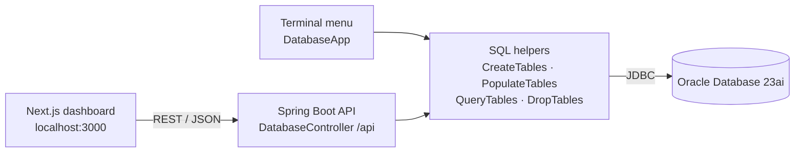
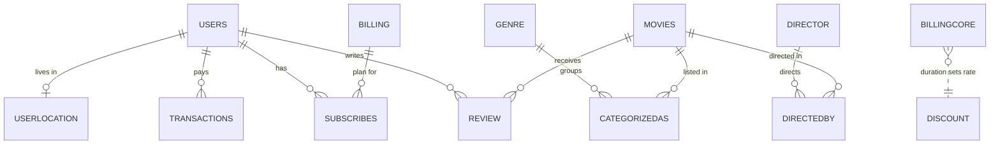

# Movie Platform DB

A full-stack admin dashboard for a movie-streaming platform's database: build the schema, load sample data, edit any table, and run analytical SQL from the browser.

**Tech Stack:** Java 11 · Spring Boot · JDBC · Oracle Database 23ai · Next.js 14 · TypeScript · Tailwind CSS · shadcn/ui

## Features

- **One-click schema lifecycle:** create 15 tables and 4 views, load sample data, or drop everything.
- **Live table browser:** every table with its row count; add, edit, and delete rows from the UI.
- **Safe deletes:** removing a user or movie also clears its linked rows, in one transaction that rolls back on any error.
- **21 analytical queries:** joins, aggregates, `GROUP BY … HAVING`, `EXISTS`, `UNION`, and `MINUS` (e.g. revenue per plan, average rating per genre).
- **Normalized design:** tables checked against 3NF/BCNF, with billing data decomposed to remove a transitive dependency.
- **Terminal mode:** the same operations from a text menu (`DatabaseApp`).

## Architecture



The browser only talks to the REST API. The API runs hand-written SQL through plain JDBC (no ORM), so every table, view, and query is visible in the code. Database connection settings come from environment variables.

### Schema (core tables)



Two more link tables, `Makes` (user ↔ review) and `Involves` (movie ↔ genre), complete the 15. `BillingCore` and `Discount` are the normalized form of the billing data (see below).

## Getting Started

**Prerequisites:** Docker, JDK 11+, Maven 3.9+, Node.js 18.17+

**1. Start Oracle Database 23ai Free** (large image, about 5 GB):

```bash
docker run -d --name movie-oracle -p 1521:1521 -e ORACLE_PASSWORD=<choose-a-password> gvenzl/oracle-free:23-slim-faststart
```

Wait until `docker logs movie-oracle` prints `DATABASE IS READY TO USE!`.

**2. Run the API** (port 8080). `DB_URL` and `DB_USER` default to `localhost:1521/FREE` and `SYSTEM`.

```bash
cd backend
mvn -B package
DB_PASSWORD=<choose-a-password> java -jar target/movie-platform-db-1.jar
```

**3. Run the dashboard** (port 3000) in a second terminal:

```bash
cd frontend
npm ci
npm run dev
```

Open <http://localhost:3000> and click **Create Tables → Populate Tables → Query Tables**.

**Checks:** `npm run lint` and `npm run build` pass. There are no automated tests yet.

## Technical Decisions & Challenges

- **Plain JDBC instead of an ORM.** The goal was to work with SQL directly, so the API sends hand-written statements and returns rows as JSON maps. One generic endpoint per operation replaces an entity class per table.
- **Normalizing billing.** A plan's duration determined its discount rate (`planId → duration → discountRate`), a transitive dependency that breaks BCNF. Bernstein's algorithm split it into `BillingCore` and `Discount`.
- **One editor for every table.** The UI builds its add and edit forms from the columns the API returns, so a single component works for all 15 tables.

## Limitations

- Needs Oracle Database 23ai or newer (the sample data uses multi-row `INSERT … VALUES`).
- Built for local use: there's no authentication, and table and column names from requests go straight into SQL. Don't expose it publicly.
- The API URL is fixed to `http://localhost:8080`, and CORS only allows `localhost:3000`.
- Preset queries use fixed sample values (e.g. "Inception"), and sample users store plain-text passwords.
- No automated tests.

## Next Steps

- Check table and column names against the schema, and add authentication.
- Read the API URL from `NEXT_PUBLIC_API_URL` and add a Docker Compose file for Oracle, API, and UI.
- Let users filter the preset queries (by director, genre, or date) using bind parameters.
- Add integration tests with Testcontainers and component tests for the UI.

---

Built as a team project (3 members).

## License

[MIT](LICENSE)
